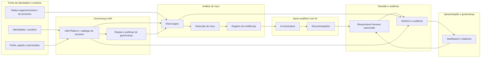
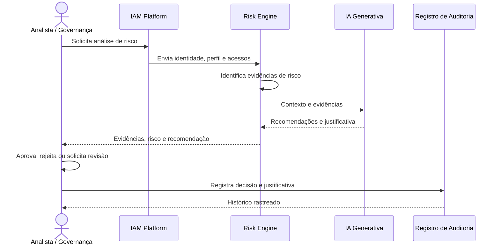

# 🔐 Identity Risk Governance

> Plataforma conceitual de governança de identidades e acessos corporativos, com análise de riscos apoiada por IA Generativa. O repositório documenta uma atividade acadêmica de discovery arquitetural e engenharia de requisitos, preservando a regra central de governança: a IA identifica riscos e recomenda; o ser humano autorizado valida e decide; o sistema registra a decisão.

## 🧠 Engenharia de Requisitos com GenAI

### Objetivo da atividade
A atividade teve como objetivo demonstrar, em um contexto de IAM, a aplicação de técnicas de engenharia de requisitos com apoio de inteligência artificial generativa, incluindo:

- identificação de requisitos funcionais e não funcionais;
- mapeamento de regras de negócio;
- análise de ambiguidades e lacunas;
- criação de casos de uso;
- definição de critérios de aceitação;
- rastreabilidade entre artefatos;
- uso crítico da IA como apoio analítico.

### Contexto
O projeto Identity Risk Governance representa uma solução conceitual de governança de identidade e acesso, com foco em tipos de risco como:

- permissões excessivas;
- privilege creep;
- contas órfãs;
- conflitos de Segregation of Duties (SoD);
- acessos privilegiados;
- ausência de justificativa de negócio;
- falhas na revisão periódica de acessos;
- evidências de risco em perfis, papéis e histórico de acesso.

### Artefatos produzidos

| Artefato | Arquivo | Objetivo |
|---|---|---|
| Requisitos funcionais e não funcionais | [docs/requisitos/01-requisitos.md](docs/requisitos/01-requisitos.md) | Definir requisitos e critérios de qualidade |
| Regras de negócio | [docs/requisitos/02-regras-de-negocio.md](docs/requisitos/02-regras-de-negocio.md) | Consolidar regras do domínio IAM |
| Ambiguidades e lacunas | [docs/requisitos/03-ambiguidades-e-lacunas.md](docs/requisitos/03-ambiguidades-e-lacunas.md) | Registrar pontos pendentes de validação |
| Casos de uso | [docs/requisitos/04-casos-de-uso.md](docs/requisitos/04-casos-de-uso.md) | Descrever interações e responsabilidades |
| Critérios de aceitação | [docs/requisitos/05-criterios-de-aceitacao.md](docs/requisitos/05-criterios-de-aceitacao.md) | Validar comportamento esperado |
| Rastreabilidade | [docs/requisitos/06-rastreabilidade.md](docs/requisitos/06-rastreabilidade.md) | Relacionar requisitos, regras, casos e critérios |
| Uso da IA | [docs/ia/07-uso-da-genai.md](docs/ia/07-uso-da-genai.md) | Documentar o papel da IA no processo |
| Sugestões da IA | [docs/ia/08-sugestoes-da-ia.md](docs/ia/08-sugestoes-da-ia.md) | Registrar inferências, ajustes e descartes |

### Regra de aprovação humana
A regra fundamental do projeto foi preservada em toda a documentação:

- IA identifica riscos e recomenda;
- Humano autorizado valida e decide;
- Sistema registra a decisão;
- Nenhuma concessão, revogação ou alteração de acesso é executada diretamente pela IA.

### Estrutura da documentação
A documentação foi organizada em duas trilhas centrais:

- [docs/requisitos](docs/requisitos) — especificação dos requisitos e regras de negócio;
- [docs/ia](docs/ia) — documentação do uso e da crítica à IA generativa.

---

## 📋 Objetivo do Projeto

O Identity Risk Governance é uma proposta conceitual de governança de identidades e acessos corporativos, voltada à análise de risco em perfis, papéis e privilégios, com apoio analítico da IA generativa. O escopo documentado cobre:

- análise de permissões excessivas;
- identificação de privilege creep;
- detecção de contas órfãs;
- verificação de conflitos de Segregation of Duties (SoD);
- sinalização de acessos privilegiados;
- avaliação de ausência de justificativa de negócio;
- revisão periódica de acessos e evidências de governança.

### Principais atores e responsabilidades

- Analista de segurança e governança: revisa evidências de risco e sugere refinamentos.
- Responsável humano autorizado: valida a recomendação, aprova ou rejeita a ação e registra a decisão.
- Sistema de análise e registro: consolida dados, evidencia o contexto e mantém o histórico de decisões.
- IA generativa: analisa padrões, contextualiza evidências e produz recomendações, sem executar concessões ou revogações de acesso.

### Restrições de segurança e integrações conceituais

- A IA não substitui o papel do responsável humano e não executa diretamente alterações de acesso.
- As integrações com fontes de identidade, permissões e auditoria são tratadas como conceituais, não como implementação comprovada.
- O projeto preserva separação de papéis, rastreabilidade e registro de decisões como requisitos centrais.
- Dados sensíveis e informações de acesso devem ser tratados com minimização, restrição de acesso e controles adequados, conforme as lacunas documentadas e a regra de governança.

---

## Discovery de Arquitetura — Diagrams as Code

### 3.1 Descrição do sistema

O Identity Risk Governance é uma plataforma conceitual de governança de identidades e acessos corporativos, voltada à análise de risco e ao suporte à decisão humana. O sistema de referência documentado sustenta a coleta de identidade, perfis, acessos e histórico, a identificação de riscos e a recomendação de tratamento, sem automatizar concessões ou revogações.

Os principais riscos avaliados são:

- permissões excessivas;
- privilege creep;
- contas órfãs;
- conflitos de Segregation of Duties (SoD);
- acessos privilegiados;
- ausência de justificativa de negócio;
- falhas na revisão periódica de acessos.

O escopo inclui os principais atores do domínio IAM, a governança de acesso, a análise de riscos, o apoio analítico da IA, a apresentação do contexto e o registro de auditoria. As integrações são tratadas como conceituais e dependem de definição de contratos, políticas e governança antes de qualquer implementação operacional.

### 3.2 Diagramas como código

Os arquivos Mermaid em [diagrams/architecture.mmd](diagrams/architecture.mmd) e [diagrams/workflow.mmd](diagrams/workflow.mmd) são as fontes editáveis e versionadas dos diagramas. O documento detalhado de arquitetura está em [docs/architecture.md](docs/architecture.md).

#### Visão estrutural

#### Visão comportamental

A visão estrutural explica os componentes e suas relações; a visão comportamental detalha o fluxo de análise, recomendação, decisão humana e auditoria. A síntese visual do README não substitui os diagramas completos em [diagrams/architecture.mmd](diagrams/architecture.mmd) e [diagrams/workflow.mmd](diagrams/workflow.mmd).

### 3.3 Análise crítica da IA

A análise crítica foi alinhada com [docs/ia/08-sugestoes-da-ia.md](docs/ia/08-sugestoes-da-ia.md) e não contradiz a regra central do projeto.

1. Inferências corretas
   - O contexto de IAM, os riscos de acesso e a necessidade de governança humana são coerentes com os requisitos e com o domínio.
   - O papel da IA como apoio analítico está alinhado com as regras de negócio e com os casos de uso.
   - A separação entre recomendação, decisão e registro de auditoria é consistente com a documentação.

2. Ajustes humanos
   - Foram corrigidas interpretações genéricas e termos excessivamente implementados.
   - O projeto foi mantido como conceitual, sem afirmar que componentes reais foram implantados.
   - Os fluxos foram revisados para preservar aprovação humana, rastreabilidade e segurança do processo.

3. Lacunas pendentes
   - Regras de negócio, critérios de risco, papéis de aprovação e políticas de retenção ainda dependem de validação com stakeholders.
   - O documento de lacunas em [docs/requisitos/03-ambiguidades-e-lacunas.md](docs/requisitos/03-ambiguidades-e-lacunas.md) permanece a referência para pontos em aberto.

### 3.4 O que falta para implementação

Antes de desenvolver um agente ou sistema operacional, ainda são necessárias definições formais para evitar inventar decisões de negócio ou tecnologia. Entre os itens pendentes estão:

- contrato de integração e formatos de dados entre fontes de identidade, permissões e auditoria;
- critérios verificáveis de risco e priorização por severidade;
- regras de SoD e matriz de conflitos por processo, função e sistema;
- matriz de permissões e papéis de aprovação por tipo de risco e nível de privilégio;
- tratamento de dados insuficientes, inconsistentes ou ausentes;
- segurança e proteção de dados enviados à IA, incluindo anonimização e minimização;
- auditoria, rastreabilidade, retenção e políticas de evidência;
- critérios de aceitação e cenários de teste com casos reais e liminares definidos;
- decisões arquiteturais aprovadas e pendências de governance ainda não confirmadas.

Esses pontos foram registrados em [docs/requisitos/03-ambiguidades-e-lacunas.md](docs/requisitos/03-ambiguidades-e-lacunas.md), [docs/requisitos/06-rastreabilidade.md](docs/requisitos/06-rastreabilidade.md) e [docs/ia/08-sugestoes-da-ia.md](docs/ia/08-sugestoes-da-ia.md), sem converter lacunas em regras arbitrárias.

---

## 🏗️ Arquitetura conceitual

### Visão Geral

A arquitetura do projeto foi tratada como uma referência conceitual para governança de identidade e riscos, não como especificação de implementação operacional. O modelo de referência considera fontes de identidade, catalogação de acessos, análise de risco, suporte analítico por IA e registro de decisões.

### Componentes principais

| Componente | Responsabilidade conceitual |
|-----------|-----------------------------|
| Fontes de identidade | Usuários, perfis, papéis, estruturas organizacionais e dados de contexto |
| IAM / catálogo de acessos | Representação de acessos, permissões, relações e regras de governança |
| Risk Engine | Identificação de riscos, evidências e priorização |
| IA generativa | Contextualização, análise e recomendação de tratamento |
| Governança humana | Aprovação, rejeição, revisão e responsabilidade da decisão |
| Auditoria e rastreabilidade | Registro de evidências, decisões e histórico |
| Apresentação | Dashboards, relatórios e apoio à avaliação humana |

### Fluxo de dados

1. A identidade e seus acessos são coletados e contextualizados.
2. O risco é analisado em relação a padrões, privilégios, permanência e conflitos de responsabilidade.
3. A IA gera recomendações baseadas em evidências e contexto.
4. O responsável humano avalia a recomendação e decide.
5. A decisão e o histórico são registrados para auditoria.

> Tecnologias e serviços citados em materiais auxiliares são tratados como referências conceituais, não como implementação confirmada do projeto.

---

## 🚦 Governança da IA

A governança da IA no projeto foi definida da seguinte forma:

- IA identifica riscos e recomenda;
- Humano autorizado valida e decide;
- Sistema registra a decisão e a evidência.

Em outras palavras, a inteligência artificial não executa ações de acesso diretamente. Sua função é apoiar a análise, a priorização e a recomendação, enquanto a decisão final continua com atores humanos autorizados.

---

## 📚 Documentação do projeto

| Documento | Descrição |
|-----------|-----------|
| [README.md](README.md) | Visão geral do projeto e atividade acadêmica |
| [docs/architecture.md](docs/architecture.md) | Arquitetura conceitual detalhada |
| [docs/requisitos/01-requisitos.md](docs/requisitos/01-requisitos.md) | Requisitos funcionais e não funcionais |
| [docs/requisitos/02-regras-de-negocio.md](docs/requisitos/02-regras-de-negocio.md) | Regras de negócio |
| [docs/requisitos/03-ambiguidades-e-lacunas.md](docs/requisitos/03-ambiguidades-e-lacunas.md) | Ambiguidades e lacunas |
| [docs/requisitos/04-casos-de-uso.md](docs/requisitos/04-casos-de-uso.md) | Casos de uso |
| [docs/requisitos/05-criterios-de-aceitacao.md](docs/requisitos/05-criterios-de-aceitacao.md) | Critérios de aceitação |
| [docs/requisitos/06-rastreabilidade.md](docs/requisitos/06-rastreabilidade.md) | Matriz de rastreabilidade |
| [docs/ia/07-uso-da-genai.md](docs/ia/07-uso-da-genai.md) | Uso da IA Generativa |
| [docs/ia/08-sugestoes-da-ia.md](docs/ia/08-sugestoes-da-ia.md) | Sugestões da IA |
| [docs/ai-usage.md](docs/ai-usage.md) | Guia complementar de uso de IA |
| [diagrams/architecture.mmd](diagrams/architecture.mmd) | Fonte editável do diagrama estrutural |
| [diagrams/workflow.mmd](diagrams/workflow.mmd) | Fonte editável do fluxo de decisão |
| [LICENSE](LICENSE) | Licença do projeto |
| [CONTRIBUTING.md](CONTRIBUTING.md) | Guia de contribuição |

---

## 📜 Licença

Este projeto está licenciado sob Apache 2.0. Consulte [LICENSE](LICENSE).

---

## 🤝 Contribuição

Contribuições são bem-vindas. Consulte [CONTRIBUTING.md](CONTRIBUTING.md).

---

## 📝 Observação final

Este repositório preserva o contexto original de IAM e governança de risco, mas incorpora a disciplina acadêmica de engineering de requisitos com apoio de IA generativa. A regra central permanece inalterada: a IA identifica riscos e recomenda; o ser humano autorizado valida e decide; o sistema registra a decisão e a evidência.

