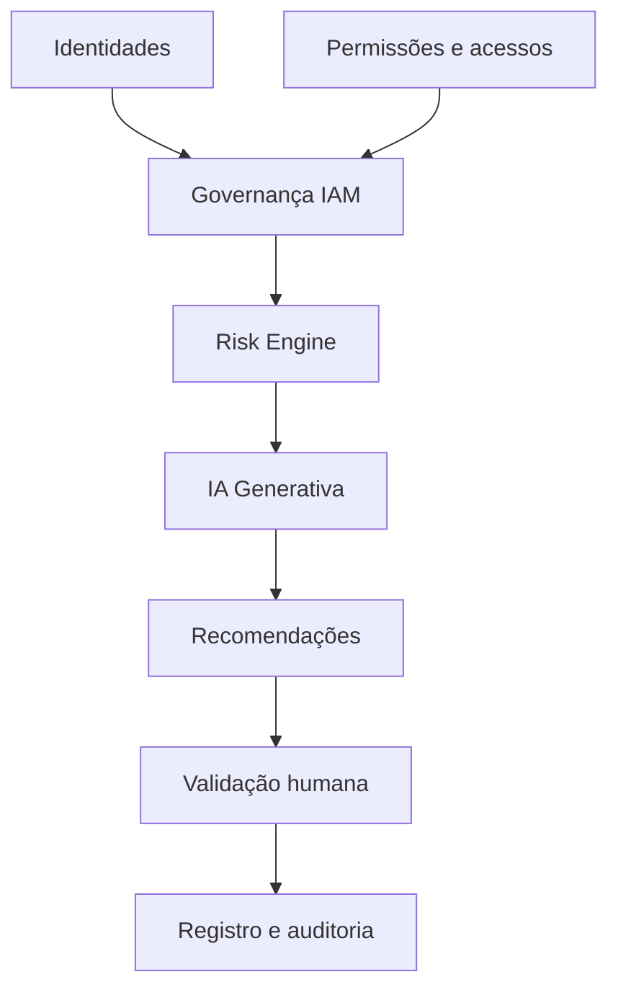
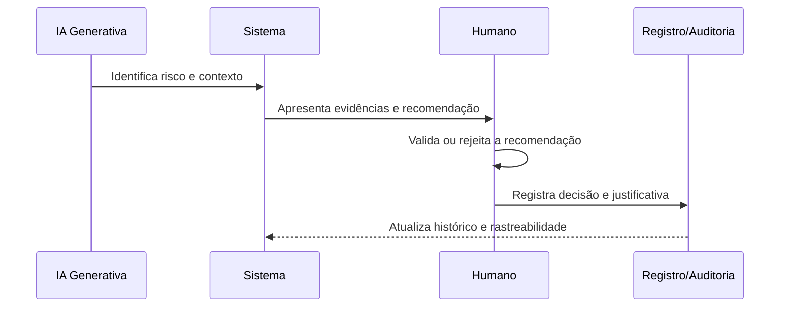
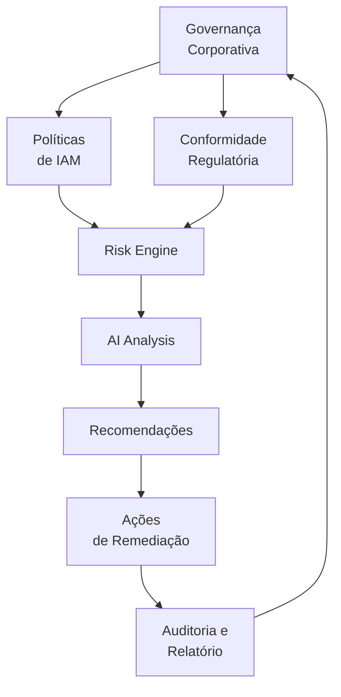

# 🔐 Identity Risk Governance

[](LICENSE)
[]()
[]()
[]()

> Plataforma conceitual de governança de identidade corporativa com análise de riscos apoiada por IA Generativa. Repositório utilizado para exercício acadêmico de Engenharia de Requisitos com IA Generativa.

## 🧠 Engenharia de Requisitos com GenAI

### Objetivo da atividade
A atividade tem como objetivo demonstrar, em um contexto realista de IAM, a aplicação de técnicas de engenharia de requisitos com apoio de inteligência artificial generativa, incluindo:

- identificação de requisitos funcionais e não funcionais;
- mapeamento de regras de negócio;
- análise de ambiguidades e lacunas;
- criação de casos de uso;
- definição de critérios de aceitação;
- rastreabilidade entre artefatos;
- utilização crítica da IA como apoio analítico.

### Contexto
O projeto Identity Risk Governance representa uma plataforma conceitual de governança de identidades e acessos corporativos, com foco em risco relacionado a:

- permissões excessivas;
- privilege creep;
- contas órfãs;
- conflitos de Segregation of Duties (SoD);
- acessos privilegiados;
- acessos sem justificativa de negócio;
- falhas na revisão periódica de acessos;
- governança de identidades.

### Artefatos produzidos
A documentação final da atividade foi organizada em artefatos de requisitos, uso da IA e rastreabilidade.

| Artefato | Arquivo | Objetivo |
|---|---|---|
| Requisitos funcionais e não funcionais | [docs/requisitos/01-requisitos.md](docs/requisitos/01-requisitos.md) | Definir requisitos e critérios de qualidade |
| Regras de negócio | [docs/requisitos/02-regras-de-negocio.md](docs/requisitos/02-regras-de-negocio.md) | Consolidar regras do domínio IAM |
| Ambiguidades e lacunas | [docs/requisitos/03-ambiguidades-e-lacunas.md](docs/requisitos/03-ambiguidades-e-lacunas.md) | Registrar pontos ainda dependentes de validação |
| Casos de uso | [docs/requisitos/04-casos-de-uso.md](docs/requisitos/04-casos-de-uso.md) | Descrever interações e responsabilidades |
| Critérios de aceitação | [docs/requisitos/05-criterios-de-aceitacao.md](docs/requisitos/05-criterios-de-aceitacao.md) | Validar comportamento esperado |
| Rastreabilidade | [docs/requisitos/06-rastreabilidade.md](docs/requisitos/06-rastreabilidade.md) | Relacionar requisitos, regras, casos e critérios |
| Uso da GenAI | [docs/ia/07-uso-da-genai.md](docs/ia/07-uso-da-genai.md) | Documentar o papel da IA no processo |
| Sugestões da IA | [docs/ia/08-sugestoes-da-ia.md](docs/ia/08-sugestoes-da-ia.md) | Registrar sugestões aproveitadas, modificadas e descartadas |

### Utilização da IA
A IA foi usada como apoio à etapa de engenharia de requisitos, incluindo:

- análise do contexto IAM;
- identificação de requisitos e regras;
- sugestão de cenários e casos de uso;
- geração inicial de critérios de aceitação;
- revisão de consistência e de lacunas;
- organização documental e rastreabilidade.

Toda decisão final foi submetida à análise crítica humana.

### Regra de aprovação humana
A regra fundamental do projeto foi preservada em toda a documentação:

- IA identifica e recomenda;
- Humano valida e decide;
- Sistema registra a decisão;
- Nenhuma alteração de acesso deve ser executada automaticamente pela IA.

### Estrutura da documentação
A documentação foi organizada em duas trilhas centrais:

- [docs/requisitos](docs/requisitos) — especificação dos requisitos e regras de negócio;
- [docs/ia](docs/ia) — documentação do uso e da crítica à IA generativa.

---

## 📋 Objetivo do Projeto

O **Identity Risk Governance** é uma solução conceitual de governança de identidade corporativa que utiliza Inteligência Artificial Generativa para:

- análise de usuários, grupos e perfis;
- identificação de riscos de identidade e acesso;
- revisão de permissões e privilégios;
- sinalização de privilege creep, contas órfãs e conflitos de SoD;
- geração de recomendações de tratamento;
- suporte à decisão humana com rastreabilidade e auditoria.

---

## 🏗️ Arquitetura

### Visão Geral



### Componentes principais

| Componente | Responsabilidade |
|-----------|------------------|
| Identity Provider | Autenticação e fontes de identidade |
| IAM Platform | Gestão de perfis, usuários e permissões |
| Risk Engine | Detecção de riscos e anomalias |
| AI/LLM | Análise contextual e recomendações |
| Audit Log | Registro de decisões e evidências |
| Governance Team | Validação e aprovação humana |

---

## 🚦 Governança da IA

A governança da IA no projeto foi definida da seguinte forma:

- IA identifica e recomenda.
- Humano valida e decide.
- Sistema registra a decisão.

Em outras palavras, a inteligência artificial não executa ações de acesso diretamente. Sua função é apoiar a análise, a priorização e a recomendação, enquanto a decisão final e a responsabilidade continuam com atores humanos autorizados.

---

## 📚 Documentação do projeto

| Documento | Descrição |
|-----------|-----------|
| [README.md](README.md) | Visão geral do projeto e atividade acadêmica |
| [docs/architecture.md](docs/architecture.md) | Arquitetura técnica detalhada |
| [docs/executive-summary.md](docs/executive-summary.md) | Resumo executivo |
| [docs/communication-plan.md](docs/communication-plan.md) | Plano de comunicação |
| [docs/ai-usage.md](docs/ai-usage.md) | Guia de uso de IA Generativa |
| [docs/requisitos/01-requisitos.md](docs/requisitos/01-requisitos.md) | Requisitos funcionais e não funcionais |
| [docs/requisitos/02-regras-de-negocio.md](docs/requisitos/02-regras-de-negocio.md) | Regras de negócio |
| [docs/requisitos/03-ambiguidades-e-lacunas.md](docs/requisitos/03-ambiguidades-e-lacunas.md) | Ambiguidades e lacunas |
| [docs/requisitos/04-casos-de-uso.md](docs/requisitos/04-casos-de-uso.md) | Casos de uso |
| [docs/requisitos/05-criterios-de-aceitacao.md](docs/requisitos/05-criterios-de-aceitacao.md) | Critérios de aceitação |
| [docs/requisitos/06-rastreabilidade.md](docs/requisitos/06-rastreabilidade.md) | Matriz de rastreabilidade |
| [docs/ia/07-uso-da-genai.md](docs/ia/07-uso-da-genai.md) | Uso da IA Generativa |
| [docs/ia/08-sugestoes-da-ia.md](docs/ia/08-sugestoes-da-ia.md) | Sugestões da IA |
| [risks/risk-register.md](risks/risk-register.md) | Registro de riscos |
| [risks/probability-impact-matrix.md](risks/probability-impact-matrix.md) | Matriz de priorização |
| [risks/response-plan.md](risks/response-plan.md) | Plano de resposta |
| [prompts/identify-risks.md](prompts/identify-risks.md) | Prompt de identificação de riscos |
| [prompts/executive-summary.md](prompts/executive-summary.md) | Prompt de resumo executivo |
| [prompts/stakeholder-report.md](prompts/stakeholder-report.md) | Prompt de comunicação |

---

## 🔐 Fluxo de análise e decisão



---

## 📜 Licença

Este projeto está licenciado sob Apache 2.0. Consulte [LICENSE](LICENSE).

---

## 🤝 Contribuição

Contribuições são bem-vindas. Consulte [CONTRIBUTING.md](CONTRIBUTING.md).

---

## 📝 Observação final

Este repositório preserva o contexto original de IAM e de governança de riscos, mas incorpora a disciplina acadêmica de engenharia de requisitos com apoio de IA Generativa, mantendo sempre a regra de que a IA não substitui a validação e a decisão humana sobre acessos corporativos.

# Gerar recomendações
# Criar Executive Summary
```

### 3. Comunicação
```bash
# Distribuir relatórios
# Comunicar riscos
# Acompanhar ações
```

### 4. Monitoramento
```bash
# Dashboard em tempo real
# Alertas automáticos
# Auditoria contínua
```

---

## 📊 Matriz de Governança



---

## 📞 Contato e Suporte

- 👤 **Arquiteto de Solução**: Especialista IAM
- 📧 **Email**: governance@company.com
- 📞 **Telefone**: +55 (XX) XXXX-XXXX
- 🕐 **Disponibilidade**: 24/7 para incidentes críticos

---

## 📜 Licença

Este projeto está licenciado sob Apache 2.0 - veja [LICENSE](LICENSE) para detalhes.

---

## 🤝 Contribuições

Contribuições são bem-vindas! Veja [CONTRIBUTING.md](CONTRIBUTING.md) para diretrizes.

---

## 📝 Changelog

- 2026-07-21T15:54-03: Atualização do README: adicionado changelog, esclarecimentos sobre uso da IA, pequenas melhorias de formatação.

**Última atualização**: 2026-07-21T15:54:16-03:00  
**Status**: 🟢 Active  
**Versão**: 1.0.1

