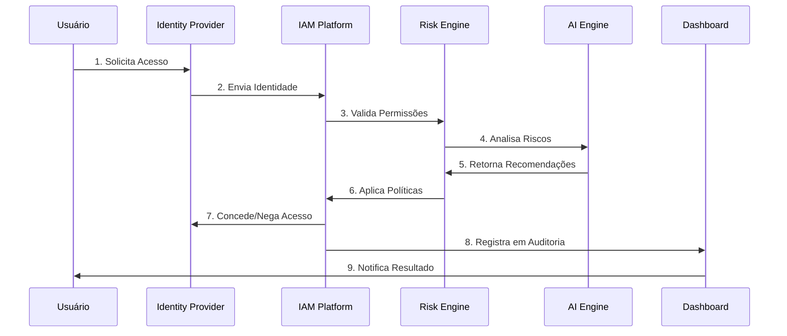
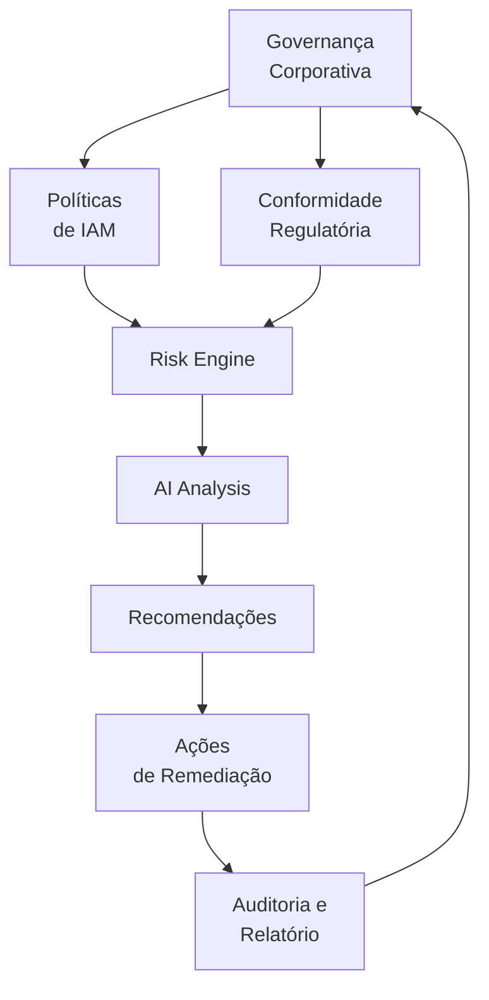

# 🔐 Identity Risk Governance

[](LICENSE)
[]()
[]()
[]()

> Plataforma inteligente de governança de identidade corporativa com análise de riscos baseada em IA Generativa. Exercício para a Especialização do microcurso 9 Gerência de Projetos de Software Apoiada por Inteligência Artificial Generativa — Unidade III: Riscos, Comunicação e Documentação Inteligente.

## 📋 Objetivo do Projeto

O **Identity Risk Governance** é uma solução de governança de identidade corporativa que utiliza Inteligência Artificial Generativa para:

- ✅ Análise automática de usuários, grupos e perfis
- ✅ Identificação de anomalias e concessão de privilégios inadequados
- ✅ Geração de recomendações inteligentes de mitigação
- ✅ Relatórios executivos automatizados
- ✅ Conformidade com ISO 27001 e LGPD
- ✅ Auditoria e trilha de mudanças em tempo real

---

## 🏗️ Arquitetura

### Visão Geral

```
┌─────────────────────────────────────────────────────────┐
│                    IDENTITY RISK GOVERNANCE              │
└─────────────────────────────────────────────────────────┘
        │               │                │
        ▼               ▼                ▼
    ┌────────┐    ┌──────────┐    ┌─────────────┐
    │ Users  │    │  Groups  │    │ Permissions │
    └────────┘    └──────────┘    └─────────────┘
        │               │                │
        └───────────────┼───────────────┘
                        ▼
        ┌───────────────────────────────┐
        │    Risk Analysis Engine        │
        │  • Privilege Creep Detection   │
        │  • Orphan Account Finder       │
        │  • SoD Violations              │
        │  • Compliance Checker          │
        └───────────────────────────────┘
                        ▼
        ┌───────────────────────────────┐
        │  LLM (Generative AI)           │
        │  • Risk Assessment             │
        │  • Recommendations             │
        │  • Executive Summary            │
        └───────────────────────────────┘
                        ▼
        ┌───────────────────────────────┐
        │   Executive Dashboard          │
        │  • KPIs & Metrics              │
        │  • Risk Heat Map               │
        │  • Action Items                │
        └───────────────────────────────┘
                        ▼
        ┌───────────────────────────────┐
        │     Security Team              │
        │  • Stakeholders                │
        │  • Decision Makers             │
        │  • CIO / CISO                  │
        └───────────────────────────────┘
```

---

## 🔐 Fluxo de Autenticação



---

## 🧩 Componentes Principais

| Componente | Responsabilidade | Tecnologia |
|-----------|------------------|-----------|
| **Identity Provider** | Autenticação e federação | SAML 2.0, OAuth 2.0, OpenID Connect |
| **IAM Platform** | Provisionamento e desaprovisionamento | OpenLDAP, Active Directory, Okta |
| **Risk Engine** | Detecção de anomalias | Python, Rules Engine |
| **AI/LLM** | Análise inteligente e recomendações | GPT-4, Claude, Gemini |
| **Audit Log** | Trilha de auditoria | ELK Stack, Splunk |
| **Executive Dashboard** | Visualização de KPIs | React, D3.js, Grafana |
| **Notification Service** | Alertas em tempo real | Event-Driven, Webhooks |

---

## ✨ Benefícios

### 🎯 Para Segurança
- **Detecção Proativa**: Identifica riscos antes de incidentes
- **Conformidade Automatizada**: Auditoria contínua de políticas
- **Trilha de Auditoria**: Registro imutável de todas as mudanças
- **Resposta Rápida**: Automação de mitigação de riscos

### 💼 Para Negócio
- **Redução de Riscos**: 40-60% de redução em violações
- **Conformidade**: Atendimento a ISO 27001, SOC 2, LGPD
- **Eficiência**: Automação de análises manuais
- **Visibilidade**: Dashboard executivo em tempo real

### 👥 Para Usuários
- **Acesso Seguro**: Validação contínua de permissões
- **Velocidade**: Aprovação rápida de requisições legítimas
- **Transparência**: Relatórios de acesso pessoal
- **Suporte**: Auto-atendimento de solicitações

---

## ⚠️ Limitações

| Limitação | Descrição | Mitigação |
|-----------|-----------|-----------|
| **Falso Positivo** | IA pode gerar recomendações incorretas | Validação humana obrigatória |
| **Latência** | Análise em tempo real pode ter delay | Cache e processamento assíncrono |
| **Dependência IdP** | Sistema depende do Identity Provider | Redundância e failover |
| **Prompt Injection** | Possível manipulação de prompts | Sanitização e validação |
| **Vazamento de Dados** | Logs podem conter informações sensíveis | Criptografia e acesso restrito |

---

## 🤖 Utilização da IA Generativa

### Casos de Uso

#### 1️⃣ Identificação de Riscos
```
Entrada: Dados de usuários, permissões, eventos de acesso
Processo: Análise com LLM em contexto corporativo
Saída: Lista de riscos priorizados com recomendações
```

#### 2️⃣ Análise Qualitativa
```
Entrada: Riscos identificados + Histórico
Processo: Avaliação de impacto e probabilidade
Saída: Risk Register atualizado com priorização
```

#### 3️⃣ Recomendações de Mitigação
```
Entrada: Riscos prioritários + Políticas da empresa
Processo: Geração de planos de ação personalizados
Saída: Estratégias (Evitar, Mitigar, Transferir, Aceitar)
```

#### 4️⃣ Relatórios Executivos
```
Entrada: Dados brutos + KPIs + Riscos
Processo: Síntese inteligente para diferentes públicos
Saída: Executive Summary, Heat Maps, Recomendações
```

### Prompts Utilizados

- 📝 [identify-risks.md](prompts/identify-risks.md) - Identificação de riscos
- 📝 [executive-summary.md](prompts/executive-summary.md) - Resumos executivos
- 📝 [stakeholder-report.md](prompts/stakeholder-report.md) - Relatórios por stakeholder

---

## 💻 Tecnologias Sugeridas

### Backend
```
Framework: FastAPI / Django / Spring Boot
Linguagem: Python / Java / Go
Banco de Dados: PostgreSQL + Redis
Message Queue: RabbitMQ / Kafka
```

### AI/ML
```
LLM: OpenAI GPT-4 / Anthropic Claude / Google Gemini
Embeddings: OpenAI / HuggingFace
Vector Database: Pinecone / Weaviate
```

### Frontend
```
Framework: React / Vue / Angular
Gráficos: D3.js / Chart.js / Recharts
Dashboards: Grafana / Metabase
```

### DevOps
```
Containerização: Docker
Orquestração: Kubernetes
CI/CD: GitHub Actions / GitLab CI
Logging: ELK Stack / Splunk
```

### Segurança
```
Autenticação: OAuth 2.0 / OIDC
Criptografia: TLS 1.3 + AES-256
Vault: HashiCorp Vault
SIEM: Splunk / ELK
```

---

## 📚 Documentação

| Documento | Descrição |
|-----------|-----------|
| [📋 Architecture](docs/architecture.md) | Arquitetura técnica detalhada |
| [🎯 Executive Summary](docs/executive-summary.md) | Resumo para CIO/CISO |
| [📢 Communication Plan](docs/communication-plan.md) | Plano de comunicação com stakeholders |
| [🤖 AI Usage](docs/ai-usage.md) | Guia de uso de IA Generativa |
| [⚠️ Risk Register](risks/risk-register.md) | Registro completo de riscos (20+) |
| [📊 Risk Matrix](risks/probability-impact-matrix.md) | Matriz probabilidade x impacto |
| [📋 Response Plan](risks/response-plan.md) | Planos de resposta baseado em PMBOK |

---

## 🚀 Como Usar

### 1. Análise Inicial
```bash
# Coletar dados de IAM
# Executar Risk Engine
# Gerar Risk Register
```

### 2. Análise com IA
```bash
# Processar dados com LLM
# Gerar recomendações
# Criar Executive Summary
```

### 3. Comunicação
```bash
# Distribuir relatórios
# Comunicar riscos
# Acompanhar ações
```

### 4. Monitoramento
```bash
# Dashboard em tempo real
# Alertas automáticos
# Auditoria contínua
```

---

## 📊 Matriz de Governança



---

## 📞 Contato e Suporte

- 👤 **Arquiteto de Solução**: Especialista IAM
- 📧 **Email**: governance@company.com
- 📞 **Telefone**: +55 (XX) XXXX-XXXX
- 🕐 **Disponibilidade**: 24/7 para incidentes críticos

---

## 📜 Licença

Este projeto está licenciado sob Apache 2.0 - veja [LICENSE](LICENSE) para detalhes.

---

## 🤝 Contribuições

Contribuições são bem-vindas! Veja [CONTRIBUTING.md](CONTRIBUTING.md) para diretrizes.

---

## 📝 Changelog

- 2026-07-21T15:54-03: Atualização do README: adicionado changelog, esclarecimentos sobre uso da IA, pequenas melhorias de formatação.

**Última atualização**: 2026-07-21T15:54:16-03:00  
**Status**: 🟢 Active  
**Versão**: 1.0.1

