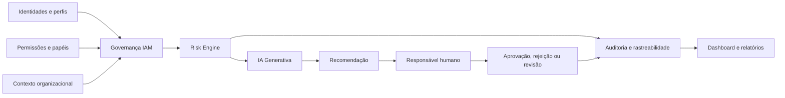

# 🏗️ Arquitetura Conceitual - Identity Risk Governance

## Objetivo

Este documento descreve a arquitetura conceitual do projeto Identity Risk Governance como referência para a atividade acadêmica de discovery arquitetural. A intenção não é afirmar uma implementação concluída, mas manter uma visão coerente com requisitos, regras de negócio, casos de uso e lacunas documentadas.

A regra central de governança permanece dominante:

- IA identifica riscos e recomenda;
- responsável humano autorizado valida e decide;
- sistema registra a decisão e a evidência;
- IA não executa concessões, revogações ou alterações de acesso diretamente.

---

## 1. Visão geral

A arquitetura conceitual do projeto organiza o funcionamento em camadas de contexto e governança:

- fonte de identidade e contexto organizacional;
- gestão de acessos e políticas de IAM;
- análise de risco e evidência;
- apoio analítico com IA;
- decisão humana e registro de auditoria;
- apresentação e consulta para governança.

A estrutura foi pensada para apoiar decisões de risco em IAM, especialmente em cenários de permissões excessivas, privilege creep, contas órfãs, conflitos de SoD, acessos privilegiados e ausência de justificativa de negócio.

---

## 2. Componentes principais

### 2.1 Fontes de identidade e contexto
- Identidades, usuários e perfis corporativos;
- dados organizacionais e funcionais;
- papéis, unidades, status e histórico de acesso;
- informações de processo e de negócio que contextualizam o risco.

### 2.2 Governança IAM
- catálogo de acessos e permissões;
- representação de perfis, papéis e relacionamentos de acesso;
- regras de governança e de segregação de responsabilidades;
- avaliação de conformidade com políticas internas e requisitos documentados.

### 2.3 Motor de risco
- detecção de permissões em excesso;
- identificação de privilege creep;
- sinalização de contas órfãs;
- verificação de conflitos de Segregation of Duties (SoD);
- avaliação de acesso privilegiado e justificativa de negócio;
- classificação contextual de risco e priorização.

### 2.4 Apoio analítico com IA
- interpretação do contexto de acesso e das evidências;
- identificação de padrões e anomalías;
- geração de recomendações com base em evidências e contexto;
- indicação de incerteza quando dados forem insuficientes.

### 2.5 Decisão humana e auditoria
- revisão formal por responsável autorizado;
- aprovação, rejeição ou solicitação de revisão;
- armazenamento do status da decisão, do responsável, do contexto e da justificativa;
- histórico de recomendações, evidências e decisões para auditoria.

### 2.6 Apresentação e governança
- painéis e relatórios para análise de risco;
- consulta ao histórico de decisões;
- acompanhamento de riscos e de ações de governança;
- suporte à revisão por analistas e stakeholders.

---

## 3. Fluxo conceitual de dados

Esse fluxo preserva a lógica do projeto: as informações de identidade e de acesso alimentam a análise, a IA gera recomendações com contexto, e a decisão final continua sendo humana, registrada e rastreável.

---

## 4. Decisões arquiteturais relevantes

### 4.1 Conceitual, não implementado
O projeto não provê evidência de uma implementação operacional completa. Portanto, a arquitetura deve ser tratada como referência conceitual e como base para descoberta e validação futura.

### 4.2 Separação de responsabilidades
A arquitetura respeita a separação entre:

- identificação de risco;
- recomendação analítica;
- decisão humana; e
- registro de evidência.

Isso é essencial para manter a governança de acesso, a responsabilidade e a rastreabilidade.

### 4.3 Riscos e decisões dependem de validação
A documentação reconhece lacunas em critérios quantitativos, regras de SoD e políticas de retenção. Nessas áreas, a arquitetura deve manter o comportamento aberto à validação de usuários, compliance e governança, sem transformar hipóteses em regras aprovadas.

---

## 5. Considerações de segurança e privacidade

- dados de identidade e acesso devem ser tratados com restrição de acesso e confidencialidade;
- o uso de IA exige minimização de dados e proteção do conteúdo enviado ao modelo;
- a explicabilidade e a rastreabilidade são requisitos centrais da recomendação;
- o histórico de decisões deve preservar evidência, responsabilidade e integridade;
- qualquer ação efetiva sobre acesso deve exigir aprovação humana autorizada.

---

## 6. Pendências documentadas

A arquitetura conceitual ainda depende de validação para:

- contratos de integração e formatos de dados;
- critérios verificáveis de risco;
- regras específicas de SoD por processo;
- política de retenção e auditoria;
- limites de uso de IA com dados sensíveis;
- matriz de papéis e aprovações humanos;
- critérios de aceitação e cenários de teste.

Essas pendências estão registradas em [requisitos/03-ambiguidades-e-lacunas.md](requisitos/03-ambiguidades-e-lacunas.md) e em [requisitos/06-rastreabilidade.md](requisitos/06-rastreabilidade.md).

---

**Versão:** Conceitual | **Status:** alinhada com requisitos e lacunas documentadas
