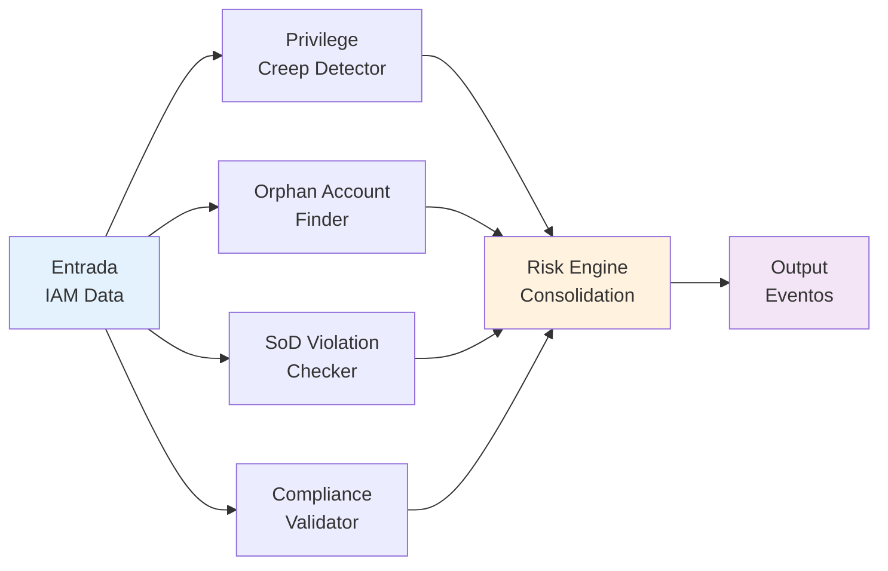

# 🏗️ Arquitetura do Identity Risk Governance

[]()
[]()

## 📑 Índice

1. [Visão Geral](#visão-geral)
2. [Componentes](#componentes)
3. [Fluxo de Dados](#fluxo-de-dados)
4. [Integrações](#integrações)
5. [Segurança](#segurança)
6. [Escalabilidade](#escalabilidade)

---

## 🎯 Visão Geral

A arquitetura do Identity Risk Governance segue o padrão **microserviços com orquestração event-driven**, permitindo:

- ✅ **Modularidade**: Componentes independentes e escaláveis
- ✅ **Resiliência**: Falha em um serviço não derruba o sistema
- ✅ **Escalabilidade**: Processamento distribuído e horizontal
- ✅ **Auditoria**: Trilha completa de eventos
- ✅ **IA Integrada**: LLM como serviço independente

---

## 🧩 Componentes

### 1. Identity Provider (IdP)

```
Responsabilidades:
├─ Autenticação de usuários
├─ Gerenciamento de sessões
├─ Federação de identidades
├─ MFA (Multi-Factor Authentication)
└─ Revogação de tokens

Tecnologias Sugeridas:
├─ Okta
├─ Azure AD
├─ Keycloak (Open Source)
└─ AWS Cognito
```

**Protocolo de Comunicação**: SAML 2.0, OAuth 2.0, OpenID Connect

---

### 2. IAM Platform (Plataforma de Gerenciamento)

```
Responsabilidades:
├─ Provisionamento de usuários
├─ Desaprovisionamento
├─ Gestão de grupos
├─ Sincronização de diretórios
├─ Gerenciamento de papéis (RBAC)
└─ Controle de acesso baseado em atributos (ABAC)

Componentes Internos:
├─ User Provisioning Engine
├─ Directory Sync Service
├─ Role Management Service
├─ Permission Service
└─ Lifecycle Manager
```

**Tecnologias Sugeridas**:
- OpenLDAP
- Active Directory
- Okta
- Identity Management Tools (Sailpoint, Delinea)

---

### 3. Risk Engine (Motor de Riscos)

Responsável pela análise de riscos em tempo real.

#### 3.1 Módulos de Detecção



#### 3.2 Regras de Negócio

| Regra | Descrição | Severity |
|-------|-----------|----------|
| **Privilege Creep** | Usuário com permissions aumentando | HIGH |
| **Orphan Accounts** | Contas sem proprietário | MEDIUM |
| **SoD Violation** | Violação de segregação de deveres | CRITICAL |
| **Inactive Users** | Contas inativas > 90 dias | MEDIUM |
| **MFA Disabled** | Usuário sem MFA | HIGH |
| **Admin Count** | Muitos admins detectados | MEDIUM |

---

### 4. AI/LLM Engine

```
Responsabilidades:
├─ Análise de contexto
├─ Geração de recomendações
├─ Síntese de relatórios
├─ Análise qualitativa
└─ Detecção de padrões anômalos

Fluxo de Processamento:
├─ Input: Structured Data + Context
├─ Processing: Prompt Engineering + Chain-of-Thought
├─ Output: Recommendations + Confidence Score
└─ Feedback: Validação e Aprendizado
```

**Modelos Sugeridos**:
- OpenAI GPT-4 / GPT-4 Turbo
- Anthropic Claude 3
- Google Gemini Pro
- Open Source: Llama 2, Mistral

**Prompt Structure**:
```yaml
Role: Especialista em Segurança de IAM
Context: Corporativo, ISO 27001, LGPD
Input: Risk Data + Historical Data
Output: Structured Recommendations
Constraints: Validação, Auditoria, Transparência
```

---

### 5. Audit Log (Sistema de Auditoria)

```
Características:
├─ Imutabilidade: Append-only log
├─ Integridade: Hashing e assinatura
├─ Retenção: Configurável por política
├─ Criptografia: Dados em repouso e em trânsito
├─ Busca: Full-text search com indexação
└─ Conformidade: ISO 27001, SOC 2, LGPD

Eventos Registrados:
├─ User Login/Logout
├─ Permission Grant/Revoke
├─ Group Membership Changes
├─ Policy Changes
├─ Risk Assessments
├─ Recommendations
└─ Administrative Actions
```

---

### 6. Executive Dashboard

```
Visualizações:
├─ KPI Metrics
│  ├─ Total Users
│  ├─ Active Risks
│  ├─ Compliance %
│  └─ SLA Status
│
├─ Risk Heat Map
│  ├─ Probability x Impact
│  ├─ Risk Trend
│  └─ Top 10 Risks
│
├─ Compliance Status
│  ├─ ISO 27001
│  ├─ LGPD
│  ├─ SOC 2
│  └─ Custom Policies
│
└─ Action Items
   ├─ Open Risks
   ├─ Pending Reviews
   ├─ Overdue Actions
   └─ Trend Analysis
```

---

## 🔄 Fluxo de Dados

### Fluxo 1: Detecção de Risco (Tempo Real)

```
1. IAM Platform
   ↓ (Event: Permission Changed)
   ↓
2. Message Queue (Kafka/RabbitMQ)
   ↓
3. Risk Engine
   ├─ Valida contra políticas
   ├─ Detecta anomalias
   └─ Determina nível de severidade
   ↓
4. Decision Tree
   ├─ Se HIGH/CRITICAL → LLM Analysis
   └─ Se LOW → Log apenas
   ↓
5. Output
   ├─ Alert (se necessário)
   ├─ Audit Log
   ├─ Dashboard Update
   └─ Recommendation (da IA)
```

### Fluxo 2: Análise Periódica (Daily/Weekly)

```
1. Scheduler (Cron)
   ↓
2. Data Extraction
   ├─ Users Database
   ├─ Permissions Database
   ├─ Events Log
   └─ Historical Data
   ↓
3. Risk Engine Analysis
   ├─ Privilege Creep Analysis
   ├─ Compliance Check
   ├─ SoD Validation
   └─ Trend Analysis
   ↓
4. LLM Processing
   ├─ Qualitative Analysis
   ├─ Prioritization
   ├─ Recommendations
   └─ Executive Summary Generation
   ↓
5. Distribution
   ├─ Executive Dashboard
   ├─ Email Reports
   ├─ Slack Notifications
   └─ Compliance Repository
```

---

## 🔗 Integrações

### Identity Providers Suportados

```
┌─────────────────────────────────────────┐
│      IAM Platform                       │
│  (Central Integration Hub)              │
└─────────────────────────────────────────┘
    ↓          ↓          ↓          ↓
    ↓          ↓          ↓          ↓
  SAML      OAuth 2.0   OIDC      LDAP
    ↓          ↓          ↓          ↓
  Okta    Azure AD   Keycloak   Active Dir
```

### External Services

| Serviço | Propósito | Protocolo |
|---------|-----------|-----------|
| **OpenAI API** | LLM Processing | REST |
| **Slack** | Notifications | Webhooks |
| **PagerDuty** | Incident Management | API |
| **Splunk** | Log Aggregation | Forwarder |
| **Datadog** | Monitoring | Agent |

---

## 🔒 Segurança

### Segurança em Camadas

```
Layer 1: Network Security
├─ VPC + Subnets
├─ Security Groups
├─ NACLs
└─ WAF (Web Application Firewall)

Layer 2: Application Security
├─ OAuth 2.0 + OIDC
├─ API Gateway + API Keys
├─ Rate Limiting
└─ Input Validation

Layer 3: Data Security
├─ AES-256 Encryption
├─ TLS 1.3
├─ Data Masking
└─ Secrets Management (Vault)

Layer 4: Access Control
├─ RBAC
├─ ABAC
├─ Principle of Least Privilege
└─ Just-In-Time Access

Layer 5: Audit & Compliance
├─ Immutable Logs
├─ Cryptographic Verification
├─ Real-time Monitoring
└─ Incident Response
```

### Proteção contra Riscos Específicos

| Risco | Mitigação |
|-------|-----------|
| **Prompt Injection** | Input sanitization + Rate limiting + Monitoring |
| **Token Leakage** | Short-lived tokens + Rotation + Vault |
| **IdP Unavailability** | Failover + Cache + Circuit Breaker |
| **AI Hallucination** | Human validation + Confidence thresholds |
| **Data Breach** | Encryption + Access logs + Audit trail |

---

## 📈 Escalabilidade

### Arquitetura Horizontal

```
Load Balancer
    ↓
    ├─── API Gateway (Auto-scaling)
    │
    ├─── Risk Engine (Multiple Instances)
    │
    ├─── AI Service (Queue-based)
    │
    ├─── Database (Read Replicas)
    │
    └─── Cache (Redis Cluster)
```

### Estratégias de Escalabilidade

| Componente | Estratégia | Limite |
|-----------|-----------|--------|
| **API** | Horizontal + Load Balancer | Infinito |
| **Risk Engine** | Message Queue + Workers | 1000+ events/sec |
| **Database** | Read Replicas + Sharding | 100M+ records |
| **Cache** | Redis Cluster | TB-level |
| **AI Service** | Queue-based async | Rate-limited por LLM |

---

## 🚀 Deployment

### Arquitetura em Produção

```
┌─────────────────────────────────────────┐
│         Kubernetes Cluster              │
├─────────────────────────────────────────┤
│ Namespace: irg-prod                     │
│                                         │
│ ├─ API Gateway (Ingress)               │
│ ├─ Risk Engine (Deployment)            │
│ ├─ AI Service (StatefulSet)            │
│ ├─ Database (StatefulSet)              │
│ ├─ Cache (StatefulSet)                 │
│ └─ Message Queue (StatefulSet)         │
└─────────────────────────────────────────┘
```

### CI/CD Pipeline

```
Code Push
  ↓
Unit Tests
  ↓
Integration Tests
  ↓
Security Scan
  ↓
Build Docker Image
  ↓
Push to Registry
  ↓
Deploy to Staging
  ↓
E2E Tests
  ↓
Deploy to Production
```

---

## 📊 Métricas e Monitoramento

### SLIs (Service Level Indicators)

| Métrica | Alvo | Alert |
|---------|------|-------|
| **Availability** | 99.95% | < 99.5% |
| **Response Time (P99)** | < 500ms | > 1s |
| **Error Rate** | < 0.1% | > 0.5% |
| **Risk Detection Latency** | < 5min | > 10min |
| **LLM Response Time** | < 30sec | > 60sec |

### Dashboard de Monitoramento

```
System Health
├─ CPU Usage
├─ Memory Usage
├─ Disk I/O
└─ Network I/O

Application Metrics
├─ Request Rate
├─ Error Rate
├─ Response Time
└─ Active Connections

Business Metrics
├─ Risks Detected
├─ Recommendations Made
├─ Actions Taken
└─ Compliance Score
```

---

## 📝 Documentação Relacionada

- 📖 [Executive Summary](executive-summary.md)
- 📖 [Communication Plan](communication-plan.md)
- 📖 [AI Usage Guide](ai-usage.md)
- ⚠️ [Risk Register](../risks/risk-register.md)

---

**Última atualização**: Julho 2026  
**Status**: ✅ Aprovado  
**Revisor**: Arquiteto de Segurança

